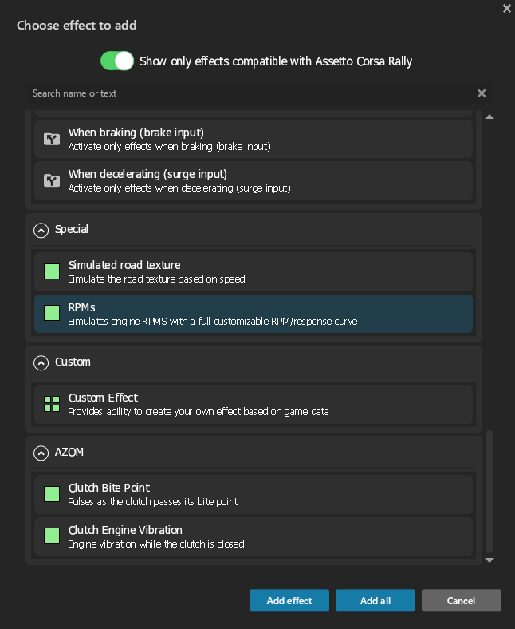
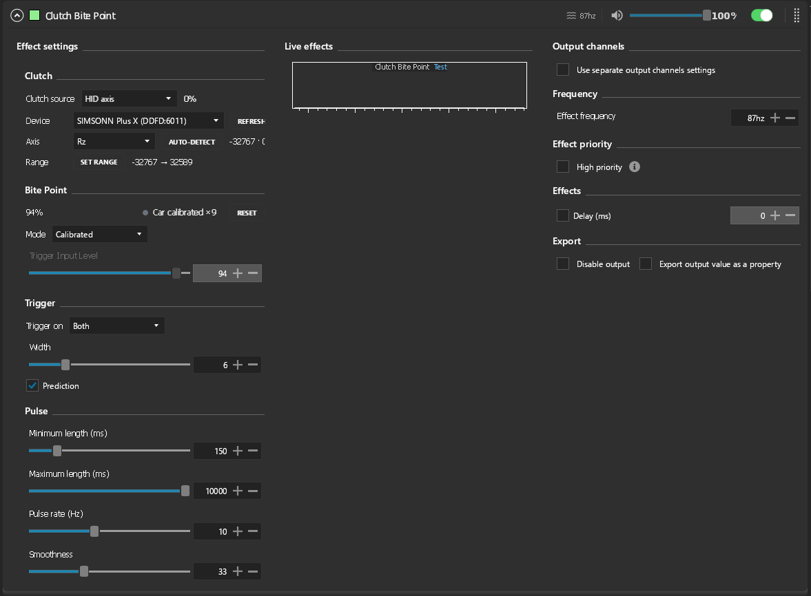
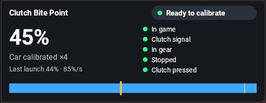
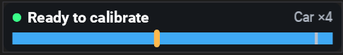
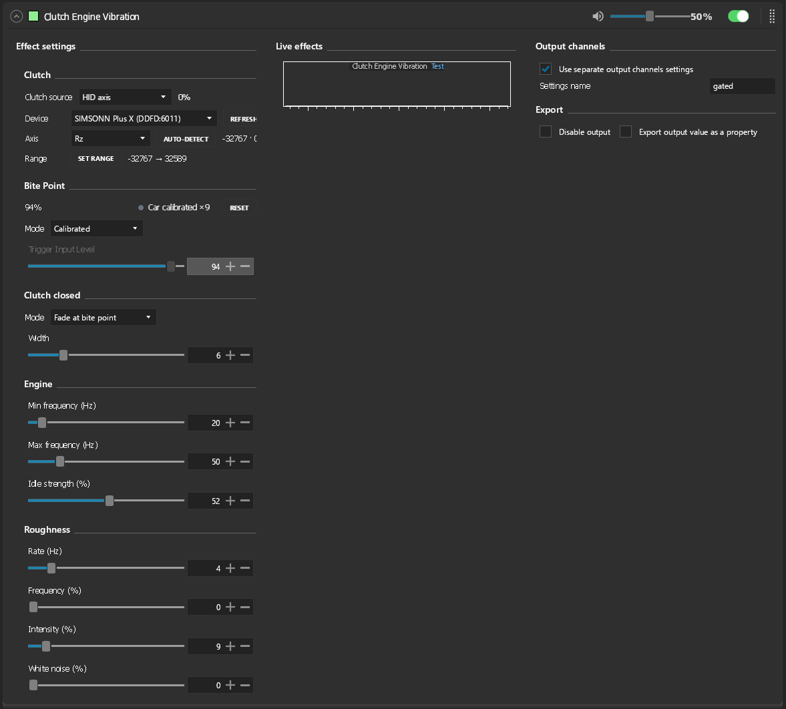

AZOM adds two effects to SimHub's ShakeIt:

- **Clutch Bite Point** pulses as the clutch passes its bite point, so you find the bite
  by feel instead of by trial and error.
- **Clutch Engine Vibration** plays engine vibration while the clutch is closed, so you
  feel the engine through the pedal when it's connected to the drivetrain.

Both use a bite point that AZOM **calibrates automatically** from your standing starts,
separately for each game and car.

> **No MOZA hardware needed.** Both effects work with every **ShakeIt Motors** and
> **ShakeIt Bass Shakers** device SimHub supports, including other brands' active pedals,
> pedal haptic units, bass shakers and motors. The clutch can come from any HID
> controller, the game's telemetry or a formula. You need only AZOM installed.

## Add the effects

Open the device's profile in SimHub's **ShakeIt Motors**, **ShakeIt Bass Shakers**, or 
**any ShakeIt device in Simhub** and add an effect. The two effects are in the **AZOM** 
group at the bottom of the **Choose effect to add** list.

Put them on the device that sits under your clutch foot, or on a seat shaker if you'd
rather feel them through the rig.

## Choose a clutch source

Both effects start with a **Clutch** section. **Clutch source** tells AZOM where to read
the clutch position. The live percentage next to it shows what AZOM is reading now.

- **mBooster pedal**: the position of a clutch-role mBooster. When an mBooster clutch is
  connected and the [mBooster tab](/guides/mbooster/) drives it, the source is locked to
  this option.
- **Game telemetry**: the clutch value the game reports to SimHub. This works with any
  pedals, but only in games that report clutch.
- **Formula**: any SimHub property or NCalc formula that returns 0–100. Click **𝑓(𝑥)** to
  edit it.
- **HID axis**: reads an axis on any game controller directly, so it works whether or not
  the game reports clutch:
  1. Pick the **Device** (**REFRESH** looks for new devices).
  2. Pick the **Axis**, or click **AUTO-DETECT** and move the clutch. The axis that moves
     furthest is selected.
  3. Click **SET RANGE**, press the clutch all the way down and let it all the way up,
     then click **DONE**. AZOM records the pedal's travel so 0 % is released and 100 % is
     pressed.

The clutch source is a single setting that both effects share. AZOM keeps a separate set
of calibrations for each source. If you change the source, the effects use that source's
calibrations.

## Calibrate with standing starts

There is no calibrate button. AZOM watches every standing start and learns from each
clean one:

1. Drive in game (not paused), with a clutch reading.
2. Stop the car fully. It must stay below 0.5 km/h for a full second.
3. Select a gear and press the clutch all the way in.
4. **Let the clutch out slowly** and pull away.

The bite point is where the clutch was when the car began to move. When the car is
clearly moving, the pedal is already past the bite, so AZOM traces the launch back to the
moment the speed started to rise.

**Slow releases only.** If you let out the full travel in less than about 0.6 s (faster
than about 167 %/s), the launch is marked **Too fast** and isn't stored. A quick release
can make the reading too low, because the game's speed output has some delay. A smooth,
deliberate launch is enough.

### Per game and per car

- The bite point is the median of the last 9 good launches, so one bad launch doesn't
  move it much.
- The first calibration in a game is saved for the game and for the car you drove.
- A new car uses the game's bite point until you do launches in it. If your first launch
  in that car is within 5 % of the game's value, AZOM continues to refine from the game's
  launches. If not, the car starts its own calibration.

The **Bite Point** section shows the value in use and its source, for example **Car
calibrated ×9** or **Game calibrated ×3**. **RESET** clears the current car's own
calibration, and the car then uses the game's value again.

### Calibrated or Manual

When a calibration exists, **Mode** shows **Calibrated** or **Manual**.

- **Calibrated** uses the learned bite point. **Trigger Input Level** shows that value
  and you can't edit it.
- **Manual** ignores the calibration and uses your own **Trigger Input Level**.

Until a calibration exists, both effects use the Trigger Input Level. Each effect has its
own Mode and level.

## Calibration overlays

AZOM installs two SimHub overlays that show the calibration while you drive. They are with
SimHub's other overlays in Dash Studio. Switch on the one you want.

**MOZA Clutch Bite Point** shows the complete picture:

- The **bite point** in use and what it was learned for (**Car calibrated ×4**).
- The **last launch**: where it bit and how fast you released (for example *44 % · 85
  %/s*). This line is amber when the launch was too fast to count.
- A **checklist** of what a standing start needs: **In game**, **Clutch signal**, **In
  gear**, **Stopped** and **Clutch pressed**. Each dot is lit when that condition is met.
- The **status**: *Not ready*, *Waiting*, **Ready to calibrate**, *Measuring* during the
  release, then *Success* with the result, or *Too fast*.
- A **clutch bar**: live clutch position, with the bite point marked in orange and a thin
  line at the fully pressed level.

**MOZA Clutch Bite Point Mini** shows only the status, the calibration count and the
clutch bar:

The Mini overlay is **hidden unless a launch can be measured**. It appears when you are
stopped, in gear and holding the clutch in. It stays during the release and shows the
result for a few seconds, then disappears. You can leave it on all the time, and it
appears only when you can calibrate.

> The overlays are display only (clicks pass through them). If you restyle them in Dash
> Studio, AZOM keeps your copy and offers new versions with an **Install update /
> Dismiss** banner, as it does for the
> [Wheelbase Control dashboard](/guides/wheelbase-control-dashboard/).

## Clutch Bite Point settings

A pulse starts when the clutch enters the zone around the bite point. It continues until
the clutch leaves the zone, within the minimum and maximum lengths.

- **Trigger on**: fire when the clutch passes the bite point while you **Press**, while
  you **Release**, or **Both**.
- **Width**: how far either side of the bite point the zone reaches, as % of clutch
  travel. The zone always stays between 5 % and the fully pressed level.
- **Prediction**: AZOM learns how fast you move the clutch and fires early on quick
  movements, so a fast clutch kick doesn't pulse late.
- **Minimum length (ms)**: every pulse lasts at least this long, even if the clutch goes
  straight through the zone.
- **Maximum length (ms)**: a pulse stops after this time even if you hold the clutch in
  the zone. It can fire again only after the clutch leaves the zone.
- **Pulse rate (Hz)**: how fast the pulse throbs.
- **Smoothness**: how even the pulse is. Higher values make the throb shallower. Lower
  values make it deeper and more distinct.

Set the tone and the overall strength with ShakeIt's usual **Effect frequency** and volume
slider.

## Clutch Engine Vibration settings

**Clutch closed** sets when the engine is felt:

- **Fade at bite point**: full strength with the clutch out, fading to nothing as you
  press through the bite zone. **Width** sets how wide the fade is.
- **Below bite point**: on whenever the clutch is pressed less than the bite point.
- **Fully released**: on only with the clutch (nearly) all the way out.
- **Always**: on whatever the clutch is doing. In this mode the effect doesn't need a
  clutch source, so the Clutch and Bite Point sections are hidden.

**Engine** sets the vibration from RPM:

- **Min frequency (Hz)** is the frequency at 0 RPM, rising to **Max frequency (Hz)** at
  the redline.
- **Idle strength (%)** is the strength at 0 RPM, rising to full at the redline.

The effect is silent when the engine is off.

**Roughness** makes the idle uneven:

- **Rate (Hz)**: how fast the roughness changes.
- **Frequency (%)**: how far the pitch swings up and down. Set it to 0 for a steady
  pitch.
- **Intensity (%)**: how deep the strength dips. Set it to 0 for a steady strength.
- **White noise (%)**: how much of the roughness is random instead of a steady pattern.

## mBooster: a pedal feel that bites

On an mBooster clutch, the calibration can also shape the pedal. With **Automatic bite
point** on, AZOM draws the Pedal Feel curve with a force peak at the calibrated bite
point, and moves the peak as you change car or game. See
[mBooster Pedal Feel &amp; Effects](/guides/mbooster/).

The mBooster tab's own **Bite Point** effect uses the same calibration and has the same
trigger and pulse settings as the ShakeIt effect above.

## Use the calibration in your own dashboards

Everything the overlays show is available as an `AZOM.ClutchBitePoint…` property, for
example the bite point, the calibration state and each standing-start condition. See the
[Properties &amp; Actions Reference](/guides/properties-and-actions/).
