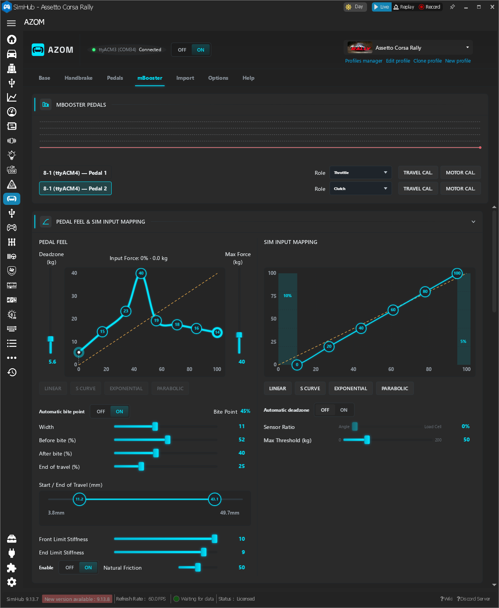
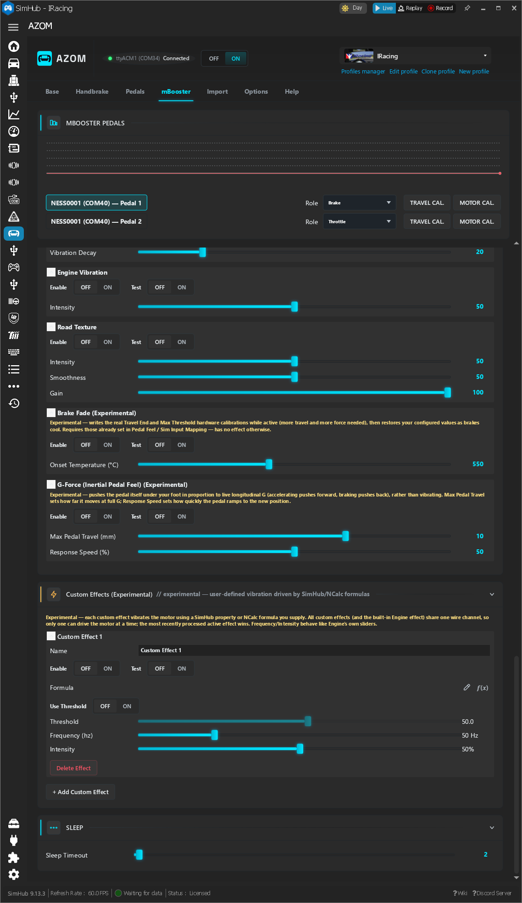
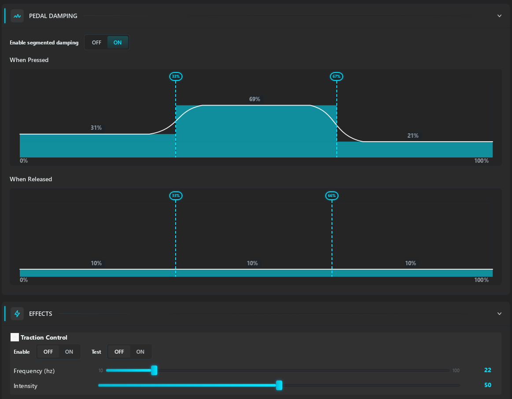
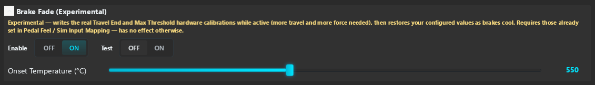

mBooster active pedals get their own tab, and it does two jobs: hardware feel calibration
(travel, stiffness and force in real units) and host-rendered haptic effects computed
from live telemetry. Multiple mBoosters on one rig are supported, either on
their own USB ports or bridged through the base. Every setting is stored per game
through SimHub's profile system.

## Pedal list &amp; roles

The **mBooster Pedals** card at the top lists one row per connected pedal over a live
trace of the last few seconds of input. Each row has a **Role** (**Throttle**, **Brake**,
**Clutch** or **Disabled**) and an editable **Display Name**, which is optional but handy
for telling two pedals with the same role apart on a multi-unit rig. Effect routing
follows each unit's own identity, not USB port order, so pedals keep their settings across
reboots and replugs.

## Pedal feel: the hardware side

The **Pedal Feel** half of the **Pedal Feel &amp; Sim Input Mapping** card writes
calibration to the pedal itself:

- **Curve**: drag the five nodes, or start from **Linear / S Curve / Exponential /
  Parabolic**, to shape resistance across the stroke.
- **Start / End of Travel (mm)**: a dual slider trimming the physical stroke in
  millimetres.
- **Front Limit Stiffness / End Limit Stiffness**: how hard the virtual end stops feel.
- **Deadzone (kg)**: force to ignore before the pedal starts registering.
- **Max Force (kg)**: the load-cell force at which the pedal reads 100 %.

### Automatic bite point (clutch)

On a clutch-role mBooster, switch **Automatic bite point** on and AZOM draws the Pedal
Feel curve for you. The force ramps up to a peak at Max Force exactly at the clutch's
**bite point**, then drops away, like the over-centre feel of a real clutch. AZOM moves
the peak to match each game and car.

The bite point is the one AZOM learns from your standing starts. See
[Clutch Bite Point &amp; Engine Vibration](/guides/clutch-bite-point/) for how
calibration works and for the overlays that show its progress. The **Bite Point**
readout shows where the peak currently is.

Shape the curve around the peak with:

- **Width**: how far either side of the bite point the peak reaches, as % of travel.
- **Before bite (%)**: the force where the peak starts, one Width before the bite point.
  The curve ramps up to this value from the start of travel.
- **After bite (%)**: the force where the peak ends, one Width after the bite point.
- **End of travel (%)**: the force at the end of the stroke.

All three force values are a percentage of the span from **Deadzone** to **Max Force**,
so those two sliders still set the overall weight.

While Automatic bite point is on, it controls the curve. The graph shows the curve the
pedal gets and you can't edit it, the presets are disabled, and **Sensor Ratio** stays on
pure **Angle**. A load-cell blend would dip after the force peak and move the bite point.
Your own curve is kept and comes back when you switch Automatic bite point off. AZOM
writes a new curve to the pedal only while the clutch is released, so the pedal never
changes under your foot.

## Sim input mapping: the game side

The **Sim Input Mapping** half of the card shapes what the game sees:

- **Curve**: same presets and draggable nodes, applied to the reported axis rather than
  the physical feel. The shaded areas at each end show the dead travel before the curve
  starts and after it ends, with their percentages.
- **Sensor Ratio**: blend between the **Angle** sensor and the **Load Cell** as the
  input source; pure load-cell braking is the usual race setup.
- **Max Threshold (kg)**: the force that maps to full input.

### Automatic deadzone

The pedal doesn't start the pedal feel travel until you press harder than **Deadzone**. But any
load-cell share in your Sensor Ratio already rises with the force, so the game can see
input before the pedal has started the pedal feel travel. **Automatic deadzone** fixes this. 
It sets the start of the Sim Input Mapping curve to the exact point where the pedal leaves the 
deadzone. The output stays at 0 through the deadzone and starts to rise when the pedal starts to 
move, for any Sensor Ratio blend.

The start point is calculated from Deadzone, Sensor Ratio and Max Threshold. It is
recalculated each time you change one of them, and it is locked while Automatic deadzone
is on. With pure Angle no offset is needed, so the start stays at 0.

## Effects

Below the curves, each effect card vibrates the pedal motor from live telemetry, with a
**Test** toggle so you can feel it parked:

- **ABS**: pulses the brake pedal when the game reports ABS activity, with Frequency,
  Intensity and Smoothness.
- **Traction Control**: mirrors the ABS pulse on the throttle side, driven by the game's
  TC flag.
- **Wheel Spin**: the acceleration-side counterpart triggered by a wheel-slip heuristic
  instead of the game's own TC decision. This helps in titles that never report TC.
- **Gear Shift**: a short pulse on every gear change, with its own **Vibrate on
  Neutral** and **Debounce** controls.
- **Road Texture**: rumble scaled by vertical chassis movement.
- **Lockup**: warns through the brake pedal when a wheel stops rotating under braking.
- **Threshold**: a pulse as you cross a configurable brake force, for training a
  consistent braking point.
- **Engine Vibration**: continuous rumble whose frequency tracks RPM toward redline;
  you set only the Intensity.
- **Bite Point**: clutch only. Pulses as the clutch passes its bite point, so you feel
  the engagement point instead of hunting for it. It uses the bite point AZOM learns from
  your standing starts, and has the same trigger and pulse settings as the ShakeIt
  version. See [Clutch Bite Point &amp; Engine Vibration](/guides/clutch-bite-point/).

> **One channel for engine-style effects.** Traction Control, Wheel Spin, Gear Shift and
> any custom effect share Engine Vibration's wire channel, so only one of them drives the
> motor at a time. The most recently active effect wins.

## G-Force: inertial pedal feel (experimental)

**G-Force** doesn't vibrate: it *moves* the pedal under your foot in proportion to live
longitudinal G, pushing forward as you accelerate and back as you brake. **Max Pedal
Travel (mm)** sets how far it moves at full G, and **Response Speed** sets how quickly it
ramps to the new position. It has the same **Test** toggle as the vibration effects.

## Segmented damping (experimental)

**Segmented Damping** adds a damping force that is independent of anything the game sends.
Pedal travel is divided into segments, each with its own range and its own damping amount,
and separate curves for **When Pressed** and **When Released**, so the pedal can feel
heavy coming down and light coming back, or the reverse.

Drag a divider to resize a segment; drag inside a segment to set its damping.

## Custom effects (experimental)

**Add Custom Effect** creates a user-defined effect: give it a name, a SimHub property or
NCalc formula, and Frequency/Intensity like the Engine sliders. A threshold mode fires a
pulse when the formula crosses a level; without it the effect runs continuously in
proportion to the value.

## Brake fade (experimental)

AZOM is the only plugin that offers brake fade for active pedals. **Brake Fade** simulates
cooked brakes. When the game's brake temperature goes above **Onset Temperature (°C)**,
it lengthens the real Travel End and increases Max Threshold as the temperature continues
to rise, so you need more travel and more force. Your configured values come back as the
brakes cool. It needs Travel End and Max Threshold already set in Pedal Feel / Sim Input
Mapping.

> **Regular pedals?** Direction, range and output curves for standard (non-motorised)
> pedals live on the [Pedals tab](/guides/pedals-and-handbrake/). Passive pedals don't
> get vibration effects.
