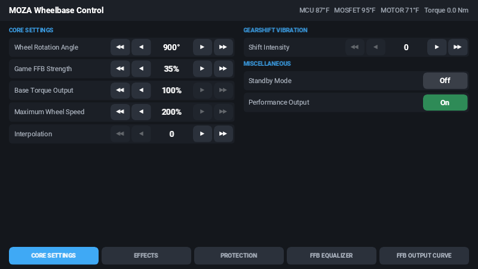
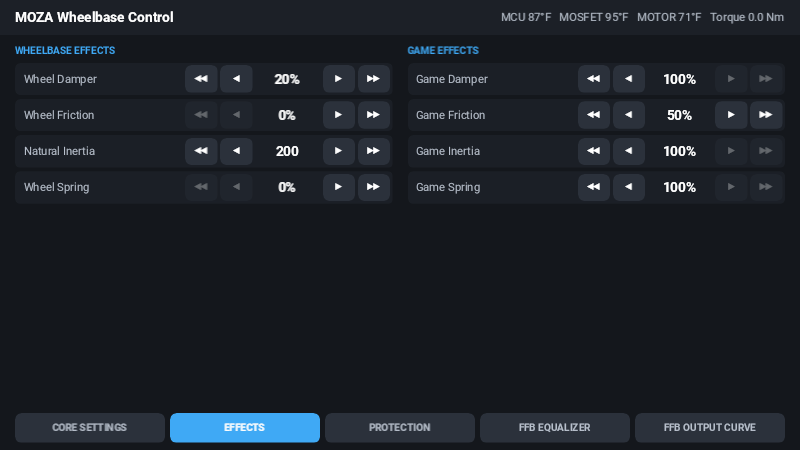
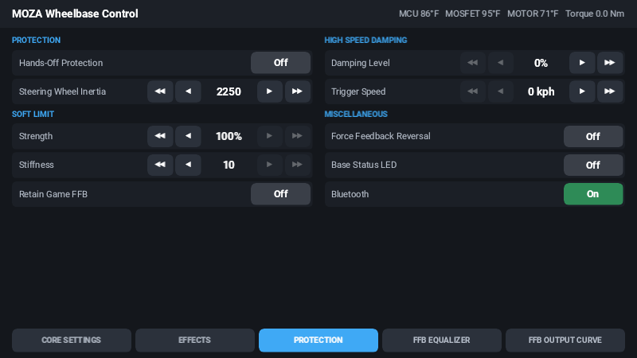
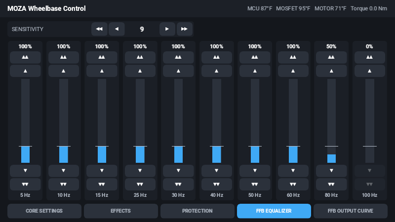
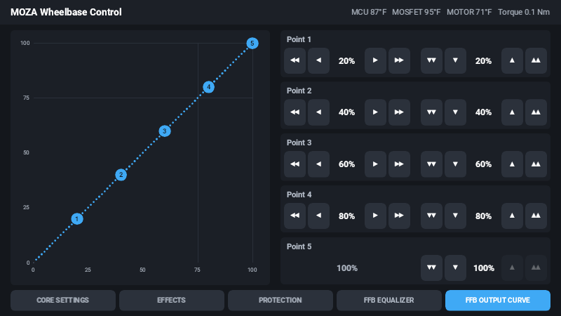

**MOZA Wheelbase Control** is a SimHub dashboard that AZOM installs for you. It puts the
main settings from the [Base tab](/guides/configure-the-wheelbase/) on five touch pages,
so you can change rotation, FFB strength, damping, the equalizer or the output curve from
a phone or tablet beside the wheel, without leaving the sim.

## Open it

You don't need to download or import anything. When SimHub starts, AZOM adds **MOZA
Wheelbase Control** to Dash Studio's dashboard list. Open it on a phone or tablet in the
same way as any other SimHub dashboard, through SimHub's web dash. You can also open it on
a monitor and click the buttons with the mouse.

Labels are in the plugin's UI language, and temperatures use SimHub's temperature unit.

## How the controls work

Every setting takes one row. Each number has a **◄◄ ◄ value ► ►►** stepper:

- **◄ / ►** apply a fine step.
- **◄◄ / ►►** apply a coarse step.

The step sizes are the same as the matching `…Up` / `…UpCoarse` actions in the
[Properties &amp; Actions Reference](/guides/properties-and-actions/). On/off
settings have a single button that shows **On** (green) or **Off**.

A few behaviours to know:

- **Buttons grey out at the limit.** If a step would do nothing because the value is
  already at its minimum or maximum, that button is disabled.
- **Unsupported settings are hidden.** If your base doesn't report a setting, its row
  doesn't appear.
- **Changes are the real thing.** A tap does the same as moving the slider on the Base
  tab. The value goes to the base immediately and is saved to the active profile.

The top bar always shows the base's **MCU**, **MOSFET** and **motor** temperatures and the
live **torque**. If the base disconnects, the bar shows **Disconnected** in red and every
button is disabled until the base comes back.

Use the buttons along the bottom to change pages.

## Pages

### Core Settings

**Wheel Rotation Angle**, **Game FFB Strength**, **Base Torque Output**, **Maximum Wheel
Speed** and **Interpolation**, plus **Shift Intensity** (gear-shift vibration), **Standby
Mode** and **Performance Output**.

### Effects

The base's own **Wheel Damper**, **Wheel Friction**, **Natural Inertia** and **Wheel
Spring** on the left. On the right, the **Game Damper**, **Game Friction**, **Game
Inertia** and **Game Spring** gains, which scale the game's effects.

### Protection

**Hands-Off Protection** and **Steering Wheel Inertia**; the soft limit's **Strength**,
**Stiffness** and **Retain Game FFB**; **High Speed Damping** level and trigger speed; and
the **Force Feedback Reversal**, **Base Status LED** and **Bluetooth** toggles.

### FFB Equalizer

**Sensitivity** at the top, then a column per band, from the lowest frequency to the
highest. **▲ / ▼** apply a fine step and **▲▲ / ▼▼** a coarse step. Bases with 6-band
firmware show six bands instead of ten.

### FFB Output Curve

The plot updates live as you edit. Each point has its own card: **◄ / ►** move the point's
input (X) and **▼ / ▲** move its output (Y). A point can't pass the points on either side
of it. **Point 5** sits at 100 % input, so you can change only its output.

## Customising it

You can open the dashboard in Dash Studio and restyle it like any other. AZOM won't
overwrite your copy. When a new plugin version changes the dashboard, a banner in the
plugin offers **Install update** or **Dismiss**. Install update replaces your copy, and
Dash Studio keeps the old one in its `_Backups` folder. If you haven't edited the
dashboard, updates install silently.

> **Want buttons instead of a touchscreen?** Every control on this dashboard is also a
> bindable action. See [Controls &amp; Actions](/guides/controls-and-actions/) to put
> them on wheel buttons or a button box.
